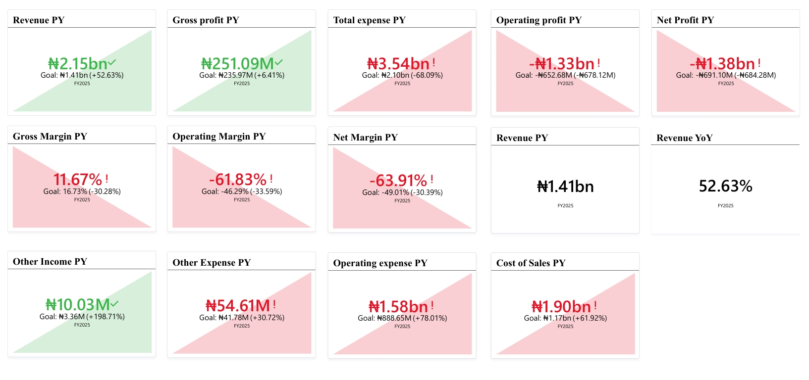
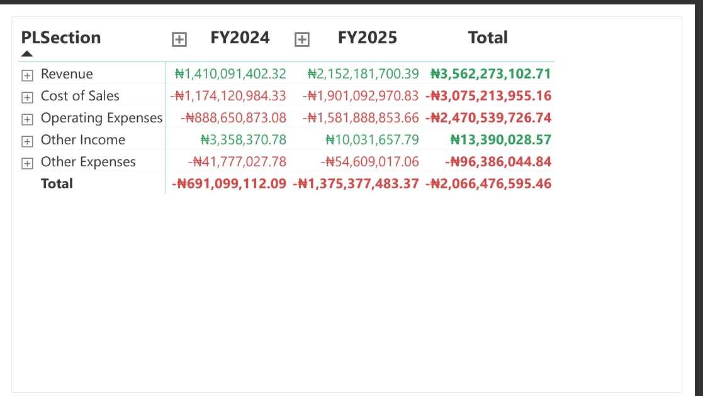
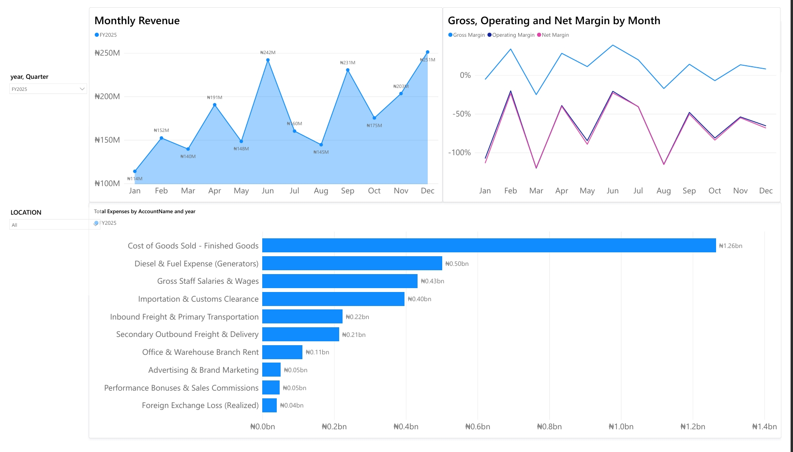
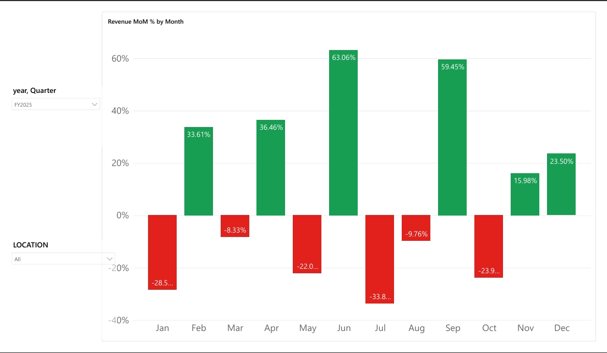
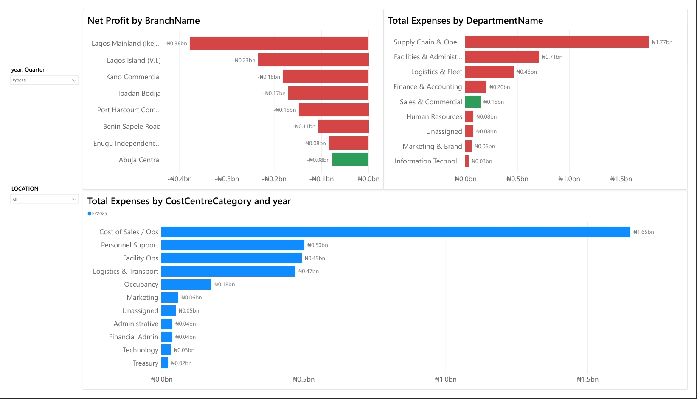
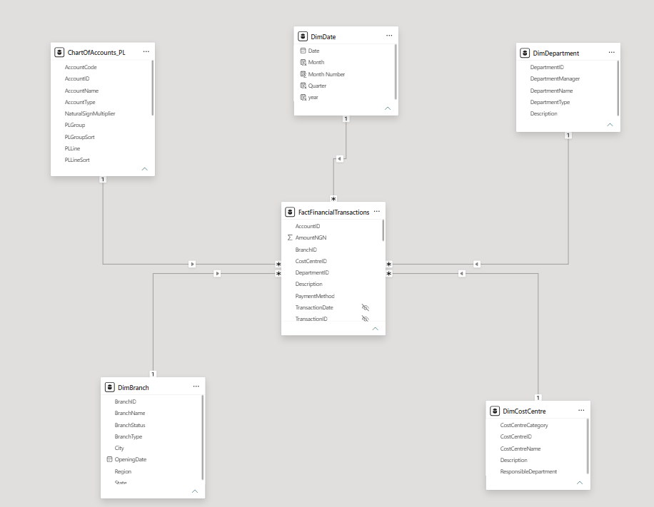

# DSA-Finsight-Financial-Analytics
Power BI project showcasing data analysis, interactive visualisation, dashboard development, and data-driven insights for a Nigerian FMCG distributor.

## Contents
- [Overview](#Overview)
- [Key Findings](#Key-findings)
- [Dashboard Preview](#dashboard-preview)
- [Data Model](#data-model)
- [Measures](#key-measures)
- [Recommendations](#recommendations)
- [How to Use](#how-to-open-the-report)

## Overview
FinSight Distribution & Consumer Products Ltd is a Nigerian FMCG distributor, operating across eight branches in Nigeria. There was an increase in revenue, but profit did not, this raises a concern for the management, the managing director wants to know why. The brief called FY2024–FY2025 revenue, operational cost drivers, profitability, and branch performance using Power Query, DAX, and a star-schema data model.
**Outcome:** Revenue increased 52.6%, but the net loss widened because energy,
freight, and import costs grew substantially faster than sales.

## Key Findings
- Margins fell at every level. Gross margin dropped from **16.7%** to **11.7%**, operating margin from **-46.3%** to **-61.8%**, and net margin from **-49.0%** to **-63.9%**.
- Product cost is not the main cause. Cost of goods sold grew **37.6%**, slower than revenue. The squeeze comes from the lines around it.
- Energy, freight and import costs surged. Diesel and fuel rose **183%**, inbound freight **185%**, outbound freight **190%** and importation and customs **135%**. Together, freight and customs rose from about **₦0.32bn** to **₦0.83bn**.
- Operating expenses outpaced sales. They rose **78%**, from **₦0.89bn** to **₦1.58bn**, about 25 points faster than revenue. The facility operations and logistics cost centres each grew from about **₦0.18bn** to roughly **₦0.48bn**.
- Seven of eight branches lost more. Lagos Mainland had the largest swing, from a **₦132m** loss to **₦378m**. Abuja Central was the only branch that improved.
- Revenue is uneven. Monthly revenue moved between **-34%** and **+63%** during 2025, which makes cash planning harder.

## Dashboard Preview

*KPI Overview dashboard summarizing the company's financial performance.*
___

*Profit and loss statement with FY2024 and FY2025 comparisons.*
___

*Revenue, margin trends, and expense breakdown.*
___

*Month-on-month revenue analysis.*
___

*Branch and department performance analysis.*

## Data
The dataset comes from the Project file. Amounts are in Nigerian naira (NGN), covering January 2024 to December 2025.

| **Table** |	**Rows** |	**Role** |
|---|---| --- |
| FactFinancialTransactions |	4,500 |	Fact table with one row per ledger posting |
| DimAccount |	38 |	Chart of accounts and P&L layout |
| DimDepartment |	10 |	Corporate departments |
| DimBranch |	8	| Branch locations |
| DimCostCentre |	12 |	Functional cost pools |
| DimDate |	built in DAX |	Calendar table for time intelligence |

## Data model
A star schema with the fact table in the centre. Each dimension joins to the fact table one-to-many, with a single filter direction. The date table is created in DAX and joined on TransactionDate.

*Star-schema data model connecting financial transactions with account, department, branch, cost-centre, and date dimensions.*

## Cleaning steps
- Converted TransactionDate from text to date.
- Replaced 96 blank DepartmentID and 58 blank CostCentreID values with "Unassigned", and added matching rows to the dimensions so these transactions stay in the totals.
- Checked eight repeated transaction references. Each pair has a different date and amount, so all rows were kept.
- Removed the duplicate chart of accounts table and trimmed DimAccount to the columns the P&L uses.
- Confirmed that every debit and credit flag matches its account's normal balance. Amounts are all positive, so the sign logic lives in the measures.

## Key measures
Revenue, cost of sales, operating expenses, total expenses, gross, operating and net profit, three margins, prior-year and YoY versions of each, and a month-on-month revenue measure. The full list with DAX is available in [Measures](Documents/measures.md).

## Findings
- Margins fell at every level. Gross margin dropped from 16.7% to 11.7%, and net margin from -49.0% to -63.9%.
- Diesel and fuel rose 183%, inbound freight 185%, outbound freight 190% and importation and customs 135%.
- Operating expenses rose 78%, about 25 points faster than revenue.
- Seven of eight branches lost more than in 2024. Lagos Mainland had the largest swing, from a ₦132m loss to ₦378m. Abuja Central was the only branch that improved.
- Monthly revenue swung between -34% and +63% in 2025.

## Recommendations
1. Cut energy costs. Buy fuel in bulk, service generators on a schedule, and add solar or hybrid power at the highest-use branches.
2. Renegotiate freight and import costs. Tender haulage contracts, consolidate shipments, review clearing agents and stock regional hubs. Had these lines grown only in line with revenue, FY2025 costs would have been about ₦0.57bn lower.
3. Put the loss-making branches on a cost and pricing plan. Start with Lagos Mainland, Lagos Island, Ibadan and Kano.
The full write-up is in [Management Narrative](Documents/management-narrative.md).

## Tools
1. Power BI Desktop
2. Power Query
3. DAX

